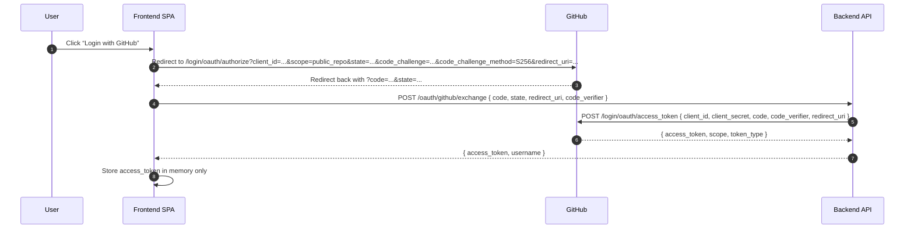

# Plan: Authenticated “Propose Metric” Flow

## 1. High-Level Architecture Overview

Goal: Add an authenticated in-app “Propose metric” form that creates a GitHub issue via API using the user’s OAuth token, while keeping the current prefilled issue link for static deployments.

Current relevant assets and constraints:
- Issue template lives at `.github/ISSUE_TEMPLATE/metric.yml`.
- Parser expects GitHub issue body sections with exact headings and order (see `scripts/issue-to-metric.ts`).
- Propose link today is a direct issue-form URL from `src/lib/proposeMetric.ts` and used in `src/components/AppHeader.vue` and `src/views/OverviewView.vue`.

Target architecture (Mode B only):
- Frontend route `/propose-auth` renders an authenticated proposal form.
- OAuth flow uses GitHub OAuth App authorization code and a backend exchange endpoint.
- After auth, frontend builds the issue payload (title, body, labels) matching the current issue template and calls `POST https://api.github.com/repos/{owner}/{repo}/issues` with the user’s token.
- `{owner}/{repo}` are derived from `VITE_REPO_URL`.
- The existing GitHub Action and `scripts/issue-to-metric.ts` remain the parser of record.

Mode A (static):
- The app is built without any auth UI, routes, or GitHub API client logic.
- The “Propose a metric” button remains a simple external link to `.../issues/new?template=metric.yml`.

## 2. Compile-Time Feature Gating Strategy

Flag: `VITE_FEATURE_AUTH_PROPOSE_METRIC=true|false`

Enforcement goals:
- When `false`, no auth code, no OAuth dependencies, and no authenticated routes are bundled.
- When `true`, auth UI, routes, and GitHub API client are bundled.

Proposed strategy:
- Introduce a build-time constant in a single file, e.g. `src/lib/featureFlags.ts`:
  - `export const FEATURE_AUTH_PROPOSE_METRIC = import.meta.env.VITE_FEATURE_AUTH_PROPOSE_METRIC === "true";`
- Ensure all auth-only imports are gated behind that constant to enable tree-shaking.
  - Example: in `src/router.ts`, add auth routes only within a compile-time branch:
    - `if (FEATURE_AUTH_PROPOSE_METRIC) { const { authRoutes } = await import("./features/authPropose/routes"); routes.push(...authRoutes); }`
    - Use top-level `await` in Vite (supported) so the router is created after the conditional import.
  - Auth views/components must live in a dedicated `src/features/authPropose/` module that is only reachable from the gated import.
- Update `src/components/AppHeader.vue` (and any other entry points) to choose between:
  - External link (when flag is false)
  - Internal route `/propose-auth` (when flag is true)
- Ensure no auth-only dependency is referenced by non-gated modules. This includes:
  - OAuth client helper(s)
  - GitHub API client helper(s)
  - Auth-specific UI components

Verification approach (no code yet):
- Build with `VITE_FEATURE_AUTH_PROPOSE_METRIC=false` and inspect output to confirm the absence of auth chunks.
- Build with `VITE_FEATURE_AUTH_PROPOSE_METRIC=true` to confirm auth chunks are present and routes registered.

## 3. OAuth Flow Sequence

OAuth App flow with backend code exchange.

Notes:
- Use `state` to mitigate CSRF and PKCE for the authorization code exchange. Persist `state` and `code_verifier` across redirect in `sessionStorage` (token remains in memory only).
- Scope: `public_repo` (minimum required to open issues in public repos).
- The client secret must remain backend-only.
- Backend lives on the same domain as the SPA in server mode.

## 4. Data Model For Form State

Reuse existing domain types from `src/lib/metrics.ts` and keep proposal-specific fields minimal.

Suggested form state (TypeScript shape):
- `title: string` (required)
- `id: string` (required, kebab-case)
- `phase: string` (required, SSDLC phase id)
- `description: string` (required, markdown)
- `measurement?: string`
- `rationale?: string`
- `notes?: string`
- `tags: string[]`
- `related_tools: string[]`
- `depends_on: string[]`
- `thresholds: Threshold[]` (from `src/lib/metrics.ts`)
- `references: string[]`

Data sources for select/autocomplete:
- SSDLC phases from `useMetricsCatalogue().phases` (source: `metrics/index.json`)
- Tags and related tools derived from `useMetricsCatalogue().metrics` (distinct values)
- Depends-on options from existing metric IDs

Validation approach:
- Reuse existing `Threshold` type and phase list.
- Extract a shared “metric id” validator to avoid divergence with `scripts/issue-to-metric.ts`.
- Immediate feedback for required fields, invalid id format, and threshold lines missing name/value.

## 5. Issue Payload Schema (Compatible With Current Workflow)

The GitHub workflow parser in `scripts/issue-to-metric.ts` expects the issue body to match the GitHub Issue Form output with the following exact headings and order:

1. `### Metric title`
2. `### Metric id`
3. `### SSDLC phase`
4. `### Description`
5. `### Measurement`
6. `### Rationale`
7. `### Tags (comma-separated)`
8. `### Related tools (comma-separated)`
9. `### Depends on (comma-separated metric ids)`
10. `### Thresholds (one per line)`
11. `### References (one URL per line)`
12. `### Notes`

Issue title:
- Format: `Metric proposal: <short title>` (matches `.github/ISSUE_TEMPLATE/metric.yml`)

Labels:
- Apply `metric-proposal` (required for automation workflow triggers).
- No additional labels or assignees.

Target repository:
- Use `VITE_REPO_URL` as the single source of truth for `{owner}/{repo}`.

Body content requirements:
- Always include every heading (even if empty) to ensure parsing.
- For empty optional fields, set content to `_No response_` (matches GitHub Issue Form behavior and parser handling).
- Threshold lines must be formatted exactly as: `Name | Value | Optional description`.

Proposed body builder:
- Add a frontend helper that assembles the body text exactly as above and is used by the authenticated flow.
- This helper should be the single source of truth for ordering and labels.

## 6. Component Structure (Vue + TypeScript)

Proposed modules (Mode B only, gated):
- `src/features/authPropose/ProposeMetricAuthView.vue`
  - Handles auth state, form, and submission.
  - Provides logout action that clears in-memory token and resets form state.
- `src/features/authPropose/components/ProposeMetricForm.vue`
  - Pure form component with validation and `submit` event.
- `src/features/authPropose/components/ThresholdEditor.vue`
  - Structured thresholds list with name/value/description inputs.
- `src/features/authPropose/components/MarkdownEditor.vue`
  - Textarea + preview using `renderMarkdown` from `src/lib/markdown.ts`.
- `src/features/authPropose/lib/buildIssueBody.ts`
  - Responsible for issue body formatting compatible with `scripts/issue-to-metric.ts`.
- `src/features/authPropose/lib/githubApi.ts`
  - Minimal helper for `POST /repos/{owner}/{repo}/issues` with user token.
- `src/features/authPropose/lib/auth.ts`
  - Auth composable (in-memory token + username, login/logout, exchange call).

Shared dependencies to reuse:
- `useMetricsCatalogue()` for phases, tags, tools, dependencies.
- `Threshold` type from `src/lib/metrics.ts`.
- `renderMarkdown()` for preview.

## 7. Routing Changes

Current router: `src/router.ts` defines static routes.

Planned changes (gated):
- Add route `/propose-auth` pointing to `ProposeMetricAuthView.vue`.
- Route must only exist when `VITE_FEATURE_AUTH_PROPOSE_METRIC=true`.
- Keep existing routes unchanged when the flag is false.

Navigation changes:
- Update “Propose a metric” CTA to:
  - External issue link when flag is false.
  - Internal route `/propose-auth` when flag is true.

## 8. Security Considerations

Frontend:
- Store OAuth token in memory only (no localStorage/sessionStorage).
- Clear token on tab refresh or explicit logout.
- Use `state` parameter to mitigate CSRF. Store `state` in `sessionStorage` or via backend session to survive redirect.
- Sanitize markdown preview output with existing `renderMarkdown` (DOMPurify).

Backend:
- Keep GitHub client secret server-side only.
- Validate `state` on exchange to prevent CSRF.
- Return only minimal payload `{ access_token, username }`.
- Consider rate limiting on `/oauth/github/exchange`.
 - Same-origin deployment simplifies CORS and CSRF handling.

GitHub API:
- Request minimal scope `public_repo`.
- Include `Accept: application/vnd.github+json` and `X-GitHub-Api-Version` headers.
- Handle 401/403 and abuse-rate-limit errors with clear UI feedback.

## 9. Open Questions and Risks

Open questions: None.

Risks:
- Divergence between the frontend issue body builder and `.github/ISSUE_TEMPLATE/metric.yml` or `scripts/issue-to-metric.ts` could break automation.
- Compile-time gating must be enforced carefully to avoid bundling auth code in GitHub Pages builds.
- In-memory-only token storage means a page refresh logs the user out, which may be surprising; UX messaging is needed.
